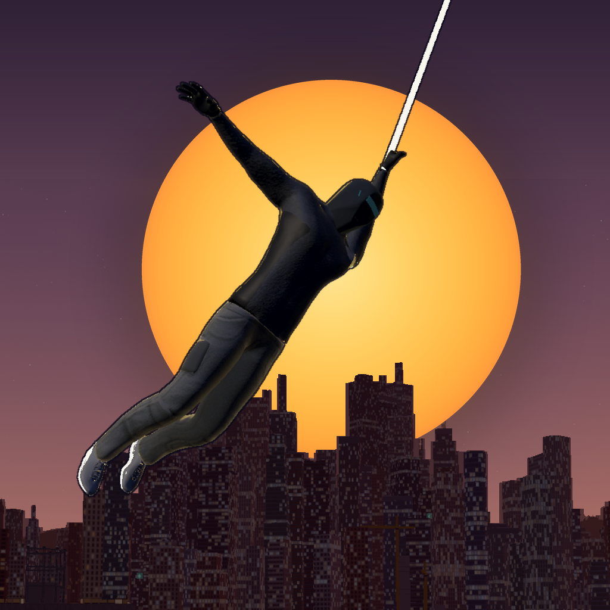

# City Swing

A skill-based, physics-driven city-swinging game for iPhone (landscape), built
with Godot 4.5 (Mobile renderer, GDScript) on a headless Linux VPS. No combat,
no story: the whole game is mastering momentum, timing and line choice.



## The swing model

`src/physics/swing_physics.gd` is a pure, deterministic model (no scene access):

- **Rope**: inextensible but can go slack. When taut, motion is integrated
  along the arc itself (rotation about the anchor), so the rope does no work:
  20 s of large swings drift < 0.15% in energy. A slack rope snapping tight is
  an inelastic jerk.
- **Gravity 19 m/s²** (tunable) so 40 m ropes swing at a readable pace;
  quadratic + linear drag bleed energy, so momentum has to be *earned*.
- **Automatic tightening conserves angular momentum** (`r·v_t = const`). The
  web shortens through the bottom of the arc, pumping energy into the swing.
  A ground launch tightens sooner to lift the player clear of the street.
- **The model's release never touches velocity.** You fly off with exactly
  what the swing gave you, plus one game-layer reward (in `player.gd`): a
  **perfect release** (flight path 20–42° above horizontal, ≥ 12 m/s) adds 10%
  speed and 2.5 m/s lift. The web glows gold while you are inside the window;
  letting go there pops "PERFECT", punches the FOV and plays a rising chime
  for each consecutive perfect release.
- **Flow assists** (all in the "Release"/"Rope"/"Impacts" params): a slack web
  snapping tight returns 70% of the lost radial energy along the swing
  (`snap_redirect`, never a gain), gravity eases to 55% near the top of a
  post-release flight (hang time to pick the next anchor), a fast glancing
  wall hit becomes a wall tap, and a head-on one below 50 m/s becomes a wall
  run up the facade. Only harder hits ragdoll.
- **Limited control authority**: tangential "kick" on the rope (4.5 m/s²),
  horizontal air steering (5 m/s², which can't push you above 9 m/s by itself),
  ground running with momentum-preserving landings, wall-kick recovery.

`src/player/player.gd` feeds the model into a Jolt `CharacterBody3D` so
collisions against buildings are real; contact normals are fed back into the
model's velocity. The grapple line travels at 280 m/s (lead your shots), and
targeting (`grapple_targeting.gd`) fans 35 rays over real building collision
geometry, penalising walls that face you (they end a swing in a collision).

Every number lives in `config/swing_params.tres` (a `SwingParams` resource),
and the in-game **Pause → Tuning** panel edits them live on the device. See
[docs/TUNING.md](docs/TUNING.md).

## Controls

| | Touch (landscape) | Controller | Keyboard/mouse |
|---|---|---|---|
| Move / steer (also aims the web) | left thumb, floating stick | left stick | WASD |
| Web | Hold **SWING** or touch the right side; it catches an available target automatically, including after a jump. Lift the owning finger to release; press with another finger to reattach. Settings offer precise building taps. | RT (assisted aim) | hold Space / LMB (assisted aim) |
| Look | automatic follow camera | right stick | captured mouse |
| Jump / wall-kick / mid-air trick | **JUMP** (just before a fast wall hit: kick off it instead of being knocked out) | A | Shift |
| Pause | ⏸ | Start | Esc |

There are no reel buttons: a taut web tightens itself through the bottom of
each arc (angular-momentum pumping), so well-timed consecutive swings build
speed, and it winches to keep the arc off the street. Each finger keeps its
own role (stick, web, jump), tracked by touch ID. If no assisted target is
available, holding SWING arms the web until one appears. In precise tap mode,
invalid building taps (sky, street, too far, blocked) show a red cross; the
SWING button remains an assisted fallback.

**Walls.** Flying head-on into a facade at ~80 km/h or more knocks you out:
the web lets go and you ragdoll off the wall. Slower hits become a short
wall run; glancing ones bounce you off. Press JUMP just before impact to
kick off the wall instead.

**Web choice.** The stick steers where the assisted web goes: pushed, the
search fan turns toward it (a gold chevron on the stick shows the direction).
The game flies the best few candidate swings with the real physics model
(through the arc, a release, and a short flight) and picks one that clears
the buildings and carries the most speed in that direction. The gold
reticle sits on that pick; in the air a dotted line previews its path.

## Modes

- **Training**: seven guided steps (fire, release, catch, 4-chain, air jump,
  90 km/h, rooftop landing), each completed by doing it. Offered first on a
  fresh save.
- **Free Swing**: the hub – contracts, homes (below) and the 40 tokens hidden over the city
  (`src/world/token_field.gd`; deterministic spots, collection saved). The HUD
  points at the nearest one.
- **Time Trial**: three courses (Canyon Sprint, Three Graces, Beacon Loop).
  Courses are **recorded from real physics**: `tools/make_courses.gd` flies
  the expert autopilot along street routes and places wall-to-wall gates along
  the line it actually flew, so every course is provably flyable.
- **Endurance**: distance without touching the street or river (stalling on a
  roof for 4 s also ends the run).
- **Benchmark** (Settings → Run 45 s benchmark): fixed autopilot route,
  records frame-time statistics on the device.

Personal bests, tokens, Training completion, the chosen suit and lifetime
stats are saved to `user://save.json`. Time Trial medals (gold = par, silver
≤ 1.25 × par, bronze ≤ 1.6 × par) and eight unlockable suit colours are derived
from that save (`src/core/progress.gd`). `tools/feel_report.gd` prints
swing-feel numbers (airborne speed, perfect releases, crashes) over several
autopilot runs, to compare tuning changes.

## Living in the city: contracts, homes, money

Free Swing is the hub. Everything below happens in it, without menus.

- **Contracts** (`src/core/contracts.gd` rules, `src/modes/job_board.gd` in
  the world). Five offers stand as columns of light on rooftops – teal for
  legal work, red for the Fence. Land on one (or fly through a rescue
  gondola / survey point) to take it; the pause menu's **Job Board** lists
  them, tracks one, and drops the current job.
  - Legal: *Rooftop Delivery*, *Express Courier* (fragile: knockouts cut
    the pay, time left adds up to +50%), *Gondola Rescue* (grab a stranded
    window cleaner off a facade, land on the medic roof), *Skyline Survey*
    (fly through 3–5 points over the roofs).
  - Underworld (~2.4× the pay): *Hot Drop*, *Getaway*, *Rooftop Heist*
    (hold still on the target roof to crack the case). Pursuit drones fly
    over the roofs and round towers; heat builds while one can see you
    (faster on the street) and cools out of sight. Full heat = busted, a
    fine of 35% of the pay. Drones top out under 30 m/s – a good swing line
    outruns them, so the escape is the movement.
  - Reputation ranks (Rookie → Runner → Courier → Pro → Ace → Legend) open
    contract tiers 1–5: longer routes, more pay.
- **Homes** (`src/world/apartments.gd`, `home_interiors.gd`): five real
  flats in real towers – each a whole floor with glass on all four sides –
  each its own design (courier studio, Scandi
  one-bed, industrial loft, marble-and-walnut sky apartment, penthouse with
  a plunge pool and a climbable mezzanine). A board on the wall shows your
  rank and records (the penthouse's is the Hall of Fame). Coming home rests
  you: starting at home or climbing in through the window lifts the coin
  multiplier to the home's level (×1 … ×3). Rooms run from 12×11 m (studio)
  to 26×20 m under a 7 m ceiling (penthouse); indoors the follow camera
  comes in closer, treats partitions and big furniture as walls and stays
  under the ceiling (`tools/home_cam_probe.gd` measures it).
  At home: the **wardrobe** (change outfit in your flat), **sleep** (wake at
  the other end of the day), the **job screen**, and a **trophy shelf**
  that fills as you progress (course medals, a rank cup, a token jar, suit
  colours). The Homes screen shows each home and lets you **visit** before
  buying.
- **Coins** come from swinging (× the multiplier), close calls, tokens and
  contracts; they buy suits, gear, gadgets and homes. Old saves load
  unchanged (new save keys default to zero).

## The city

Generated deterministically (`src/world/city_layout.gd`), loosely after
Liverpool: the river to the west with a far shore; three waterfront landmarks
(twin clock towers with domes and gilded birds, a palazzo office block, a domed
port building); a glass business district peaking around a radio beacon in a
plaza; brick docks with basins and cranes; low Georgian terraces; a sandstone
cathedral; an elevated railway along the waterfront; CBD skybridges. About 680
buildings over 1.4 × 1.9 km, with an outskirts skyline beyond.

- Models (props, landmarks, viaduct, crane, character) are built by
  `tools/blender/build_kit.py` (Blender 4.5 Python, no manual modelling).
- Building massing is meshed in Godot (`building_mesher.gd`). Windows,
  mullions, shopfronts, brick and roofs come from `building.gdshader`, so detail
  costs no vertices.
- 200 m chunks are meshed on worker threads (~1.5 ms each), with a detailed and
  a low LOD switched by visibility ranges, MultiMesh props with short ranges,
  GPU-animated traffic, and per-chunk occluders (occlusion culling on).
  Collision for every building exists up front, so traversal never waits on
  streaming.
- Sound is synthesised by `tools/audio/gen_audio.py` (wind, rope hum, SFX,
  ambience, music).

## Workflow

```
tools/build.sh                # import + all tests + Linux export self-test + iOS Xcode project
tools/build.sh assets         # …regenerating Blender models and audio first
tools/build.sh courses        # …re-recording Time Trial courses (after physics/layout changes)
tools/build.sh shots          # …plus a rendered screenshot contact sheet
tools/filmstrip.sh <name> "2,4,6" --mode=free --bot=expert   # visual review under Xvfb
godot --headless --fixed-fps 60 -s res://tools/trace_bot.gd -- expert 30 canyon   # autopilot trace
```

Tests (`tests/`, 55 of them) cover the model analytically (pendulum period,
energy, angular momentum, slack/snap, release, drag, steering limits), the
real controller in Jolt (targeting, tunnelling, wall-kick, respawn, an expert
autopilot chaining 420 m vs a novice hitting the street), the generated city
(determinism, districts, overlaps, collision, streaming, a 590 m expert run),
and the modes (recorded courses, Endurance rules, save isolation).

## iOS

The VPS exports the Xcode project; building, signing and TestFlight need a
Mac. See **[docs/IOS_BUILD.md](docs/IOS_BUILD.md)**. Status and open items are
in **[docs/STATUS.md](docs/STATUS.md)**.

## Tool versions

Godot 4.5.1-stable (`~/opt/godot`, export templates in
`~/.local/share/godot/export_templates/4.5.1.stable`), Blender 4.5.3 LTS
(`~/opt/blender`), both symlinked in `~/.local/bin`.
